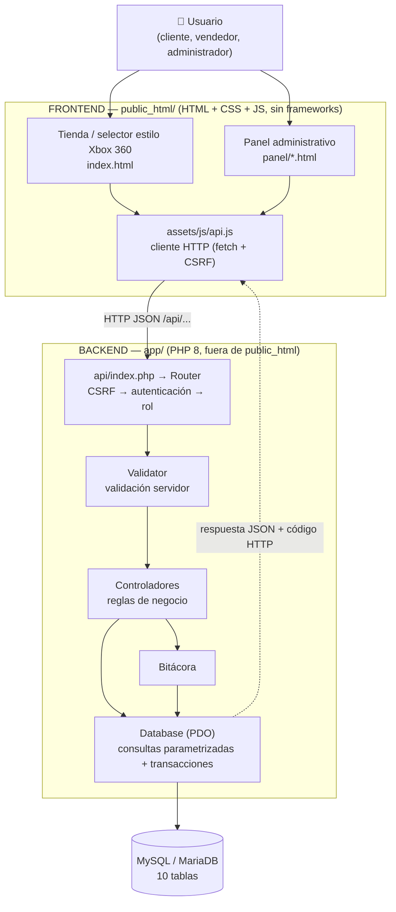

# Arquitectura

## Diagrama

## Justificación

| Decisión | Motivo |
|---|---|
| Frontend y backend separados, comunicados solo por la API REST | El navegador nunca ve credenciales ni SQL; cualquier cliente (web, móvil, Postman) usa las mismas reglas. |
| PHP 8 sin framework + MySQL | Es lo que Hostinger ofrece en cualquier plan compartido (sin Node ni Docker). Sin dependencias de Composer: se sube por FTP/Administrador de archivos y funciona. |
| `app/` fuera de `public_html` | El código del backend y el `.env` no son descargables desde internet. Si se sube dentro, un `.htaccess` lo bloquea igualmente. |
| Router con permisos por ruta | La autorización es declarativa (`app/routes.php`) y se verifica **antes** de ejecutar el controlador: conocer la URL no basta. |
| Sesión PHP + token CSRF | Cookie `HttpOnly` (JS no la lee, mitiga XSS), `SameSite`, regeneración de ID al iniciar sesión y token CSRF en cada escritura. |
| PDO con `EMULATE_PREPARES = false` | Consultas parametrizadas reales: previene SQL Injection. |
| Transacciones + `SELECT … FOR UPDATE` | Una venta toca 4 tablas; o se guarda todo o nada, y dos cajas no pueden vender la última pieza al mismo tiempo. |
| Chart.js local (`assets/vendor`) | Las gráficas no dependen de un CDN externo. |

**Limitaciones:** sin framework no hay migraciones automáticas (se usa `schema.sql`); las sesiones PHP no escalan a varios servidores sin un almacén compartido; los pagos son simulados.

## Flujo de una operación completa (venta en el punto de venta)

1. El vendedor agrega juegos al ticket en `panel/pos.html` y presiona **Cobrar** → confirmación.
2. `api.js` envía `POST /api/ventas` con `{items, metodo_pago, cliente_id}` y el encabezado `X-CSRF-Token`.
3. `Router` verifica CSRF → sesión → rol (`admin`/`vendedor`).
4. `VentaController::store` valida cantidades (>0, máx. por línea), cliente y método de pago → **422** si algo está mal.
5. Abre transacción, bloquea los juegos (`FOR UPDATE`), verifica existencias → **409** si falta stock.
6. Calcula subtotal, IVA y total con precios de la BD, inserta la venta, genera el folio, inserta el detalle, descuenta stock, registra movimientos y bitácora → `COMMIT`.
7. Responde **201** con la venta completa en JSON.
8. La interfaz muestra el ticket con folio y recarga el catálogo con el stock actualizado.
